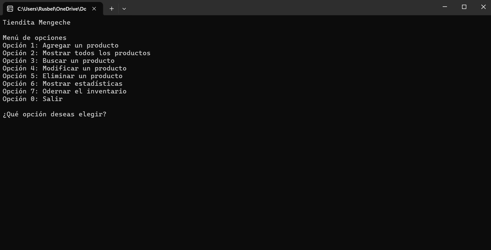
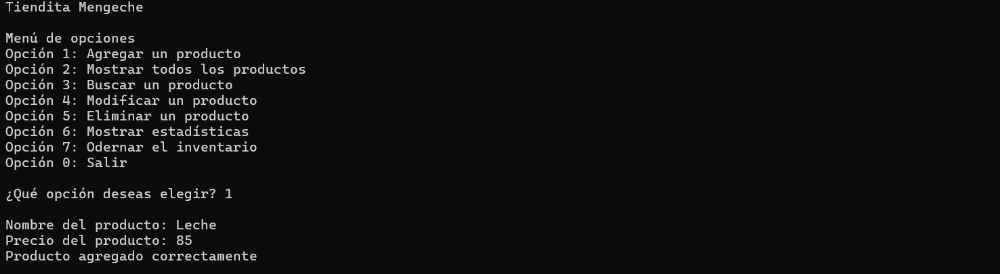
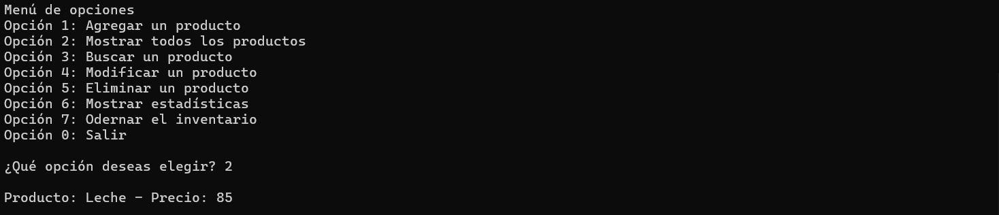
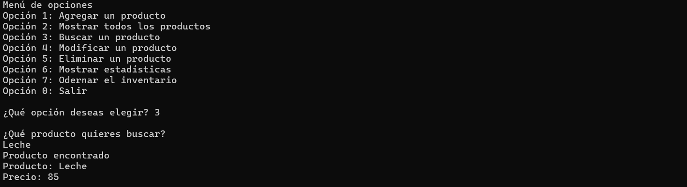
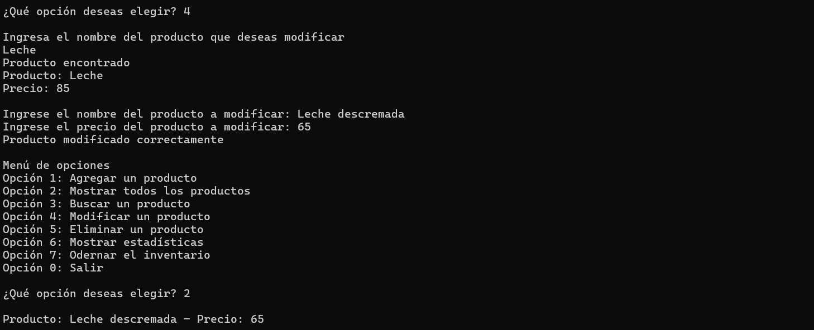
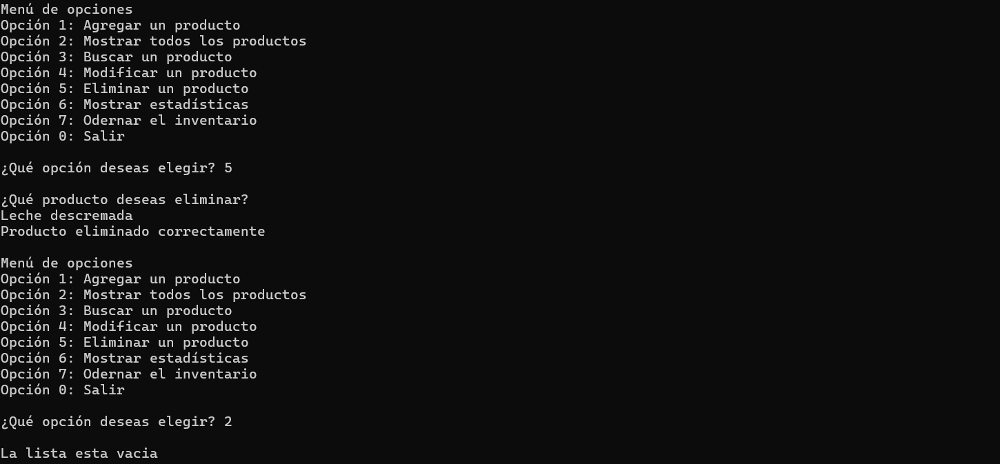
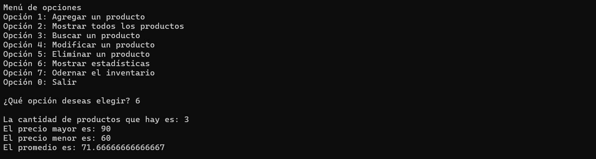
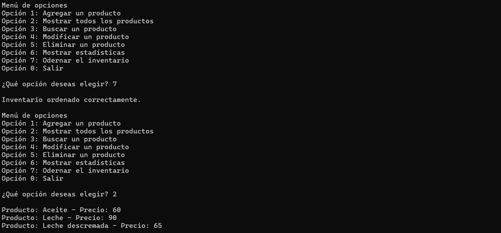

# Título
Nombre del proyecto: Tiendita Mengeche

## Descripción
La Tiendita Mengeche necesitaba una aplicación de consola para gestionar su inventario que permitiera agregar un producto, mostrar los productos, buscar un producto, modificar un producto, eliminar un producto, mostrar las estadisticas y ordenar los productos y seguir motrando un menú hasta que el usuario elija salir...

## Imagenes del proyecto

### Como se ve el menú

### Agregando un producto

### Mostrando los productos

### Buscando un producto

### Modificando un producto

### Eliminando un producto y de paso mostrando que pasaría si la lista se encuentra vacia

### Mostrando estadisticas

### Ordenando la lista

## Autor

Rusbel De La Rosa Muñoz
